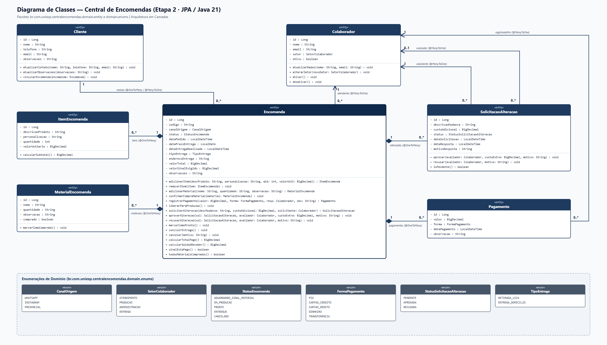

# Central de Encomendas

Sistema back-end desenvolvido para a disciplina **Tecnologias Back-End Avançado (UNIESP)**, voltado ao controle de encomendas personalizadas de uma pequena empresa com 8 colaboradores (Atendimento, Produção, Administração e Entrega).

---

## 1. Descrição do Projeto

Com o aumento das vendas pelas redes sociais, as encomendas da empresa passaram a ficar espalhadas entre WhatsApp, Instagram, cadernos e planilhas, causando retrabalho por alterações não comunicadas, atrasos por falta de material especial e entregas feitas sem conferência do pagamento restante.

A **Central de Encomendas** resolve esses problemas centralizando o pedido em um fluxo único (`AGUARDANDO_SINAL_MATERIAL → EM_PRODUCAO → PRONTO → ENTREGUE`) com proteções diretas nas regras de domínio:

1. **Liberação segura para a produção:** uma encomenda só entra em `EM_PRODUCAO` quando possui ao menos um item, o valor de sinal exigido está pago e todos os materiais especiais necessários estão marcados como comprados.
2. **Proteção contra mudanças de última hora:** depois de iniciar a produção, os itens não podem ser alterados diretamente; qualquer mudança exige uma `SolicitacaoAlteracao` avaliada pela produção, somando eventuais custos extras ao valor total do pedido.
3. **Controle de pagamentos parciais e entrega:** o sistema soma os pagamentos registrados, calcula o saldo restante e bloqueia a conclusão da entrega enquanto houver valor pendente.
4. **Visão de agenda por prazo de entrega:** a data de entrega registrada em cada encomenda permite consultar os compromissos de cada dia/fim de semana antes de prometer novos prazos (consulta a ser exposta na Etapa 3).

Itens como robôs no WhatsApp, controle de estoque peça por peça e contabilidade avançada ficaram intencionalmente fora do escopo para manter o sistema simples de usar.

---

## 2. Arquitetura Escolhida e Justificativa

### Arquitetura Adotada: **Arquitetura em Camadas (Layered Architecture / MVC)**

O sistema será organizado na arquitetura em camadas clássica do Spring Boot (`controller` → `service` → `domain` → `repository`), mantendo as regras de alteração de estado encapsuladas nas próprias entidades de domínio (evitando *setters* genéricos para status, totais e conclusões).

### Justificativa

* **Necessidades do negócio:** trata-se de uma pequena empresa com 8 colaboradores que precisa de uma solução simples, rápida de implantar e de baixo custo de manutenção, sem complexidade de infraestrutura desnecessária.
* **Complexidade do sistema:** a complexidade principal está nas transições de estado do pedido e nas validações de negócio, não em escala distribuída. A arquitetura em camadas atende bem ao problema sem precisar separar modelos de domínio e modelos de persistência em múltiplas camadas extras (como em uma Arquitetura Hexagonal).
* **Características da equipe:** o grupo é formado por 5 estudantes desenvolvendo em Java 21, Spring Boot, JPA e MySQL em prazo acadêmico curto. O padrão em camadas é familiar ao ecossistema Spring, reduz a curva de aprendizado e facilita a divisão de tarefas na próxima etapa.

---

## 3. Organização do Código

Na **Etapa 2**, está implementada apenas a camada de domínio (`domain`). Na **Etapa 3**, serão adicionadas as camadas de persistência, serviço e API REST seguindo a estrutura abaixo:

```text
src/main/java/br/com/uniesp/centralencomendas/
├── CentralEncomendasApplication.java
├── domain/                         # Implementado na Etapa 2
│   ├── entity/                     # Entidades JPA e regras de negócio
│   │   ├── Cliente.java
│   │   ├── Colaborador.java
│   │   ├── Encomenda.java
│   │   ├── ItemEncomenda.java
│   │   ├── MaterialEncomenda.java
│   │   ├── Pagamento.java
│   │   └── SolicitacaoAlteracao.java
│   ├── enums/                      # Enumerações de status, setor, canal e entrega
│   └── exception/
│       └── RegraNegocioException.java
├── repository/                     # Previsto para a Etapa 3 (Spring Data JPA)
├── service/                        # Previsto para a Etapa 3 (casos de uso e consultas de agenda)
├── dto/                            # Previsto para a Etapa 3 (entrada e saída da API)
└── controller/                     # Previsto para a Etapa 3 (endpoints REST)
```

---

## 4. Modelagem do Domínio e Diagrama UML

| Entidade | Responsabilidade | Relacionamentos JPA |
|---|---|---|
| `Cliente` | Dados de contato do cliente | `@OneToMany` com `Encomenda` |
| `Colaborador` | Funcionários por setor | Referenciado via `@ManyToOne` por `Encomenda`, `Pagamento` e `SolicitacaoAlteracao` |
| `Encomenda` | Pedido principal, prazo/dados de entrega, ciclo de vida e travas de negócio | `@ManyToOne` (`Cliente`, `Colaborador`); `@OneToMany` (`ItemEncomenda`, `MaterialEncomenda`, `Pagamento`, `SolicitacaoAlteracao`) |
| `ItemEncomenda` | Produtos personalizados, quantidade e valor unitário | `@ManyToOne` com `Encomenda` |
| `MaterialEncomenda` | Checagem simples de materiais especiais do pedido | `@ManyToOne` com `Encomenda` |
| `Pagamento` | Pagamentos parciais ou totais vinculados à encomenda | `@ManyToOne` com `Encomenda` e `Colaborador` |
| `SolicitacaoAlteracao` | Controle de mudanças após início da produção | `@ManyToOne` com `Encomenda` e `Colaborador` (solicitante e avaliador) |



* Arquivos do diagrama: [`docs/uml/diagrama-classes-dominio.png`](docs/uml/diagrama-classes-dominio.png) e [`docs/uml/diagrama-classes-dominio.puml`](docs/uml/diagrama-classes-dominio.puml).

---

## 5. Instruções para Execução

### Pré-requisitos
* **Java 21**
* **Maven 3.9+** (ou IDE com Maven embutido)
* **MySQL 8.x**

### Configuração do Banco de Dados
Configure o acesso ao MySQL em [`src/main/resources/application.yml`](src/main/resources/application.yml) ou pelas variáveis de ambiente `DB_HOST`, `DB_PORT`, `DB_NAME`, `DB_USER` e `DB_PASSWORD`. O banco `central_encomendas` é criado automaticamente na conexão se ainda não existir.

### Executar os testes (usa H2 em memória em modo MySQL)
```bash
mvn test
```

### Executar a aplicação
```bash
mvn spring-boot:run
```

---

## 6. Equipe

* Pierre Simon
* Kewy Huang
* Renan Mendes
* Caio Augusto
* Wagner
